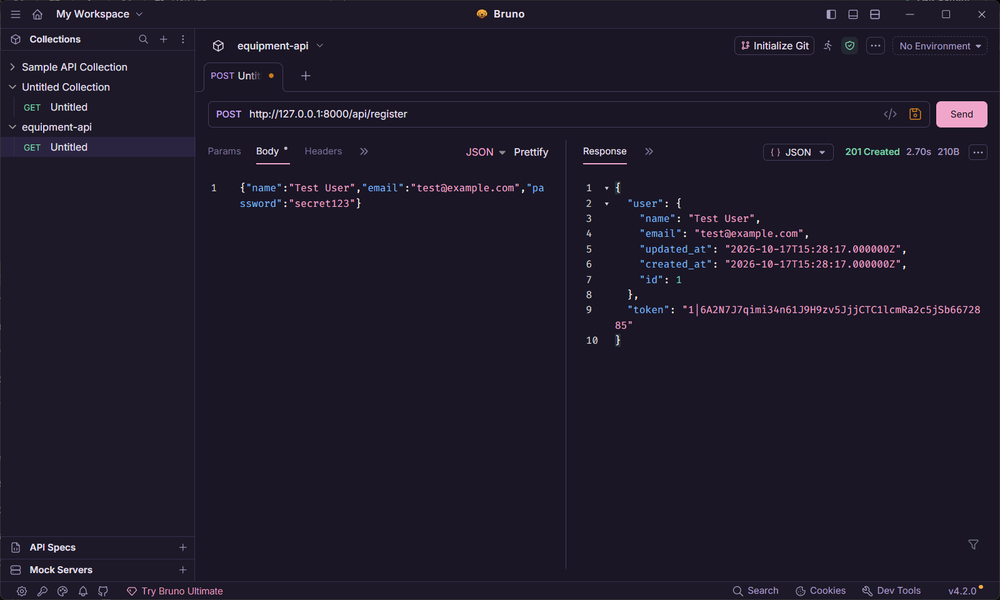
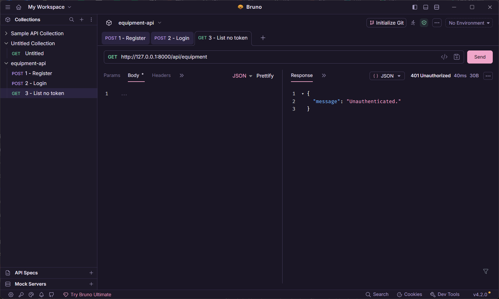
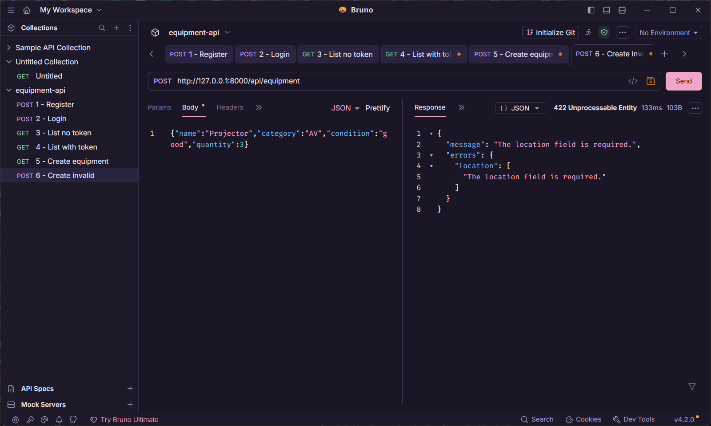

<<<<<<< HEAD
# Equipment API

**Partners:** Laquian, Karl Louie & Talawec, Yrej Jhel
**Section:** IT1E
**Resource:** Equipment (name, category, condition, quantity, location)

## Setup

```bash
git clone https://github.com/laquiankarllouie/cit3102-m5-equipment.git
cd cit3102-m5-equipment
composer install
cp .env.example .env
php artisan key:generate
php artisan migrate
php artisan serve
```

If `migrate` asks to create the SQLite database file, answer yes.
The API runs at `http://127.0.0.1:8000/api`.

## Routes

| Verb | Path | What it does | Token needed? |
|---|---|---|---|
| POST | /api/register | Creates a user and returns a token | No |
| POST | /api/login | Logs in and returns a token | No |
| POST | /api/logout | Deletes the current token | Yes |
| GET | /api/me | Shows the logged-in user | Yes |
| GET | /api/equipment | Lists equipment, with optional filters | Yes |
| POST | /api/equipment | Creates an equipment record | Yes |
| GET | /api/equipment/{equipment} | Shows one equipment record | Yes |
| PUT | /api/equipment/{equipment} | Updates an equipment record | Yes |
| DELETE | /api/equipment/{equipment} | Deletes an equipment record | Yes |

## Screenshots









## Why does DELETE return 204 and not 200?

## When we delete something, it's already gone, so there's nothing left to send back. That's why DELETE returns 204 and not 200. 204 means "No Content", which tells us the request worked but the response body is empty. A 200 usually comes with data, and a deleted record has no data to show. The status code itself is already the answer, so we don't need to add anything else.
=======
Project Title: Build Your Own API (cit3102-m5-equipment)
Partners: Karl Louie Laquian and Yrej Talawec
Section: IT1E
Resource: Equipment

SET UP STEPS
Step 1: Clone the repository:
   – git clone https://github.com/laquiankarllouie/– – – cit3102-m5-equipment.git
   – cd cit3102-m5-equipment

Step 2: Install dependencies:
   – composer install

Step 3: Create the environment file and app key:
   – copy .env.example .env
   – php artisan key:generate

Step 4: Create the database and run migrations (answer 'yes' if asked to create the SQLite file):
   – php artisan migrate

Step 5: Start the server:
   – php artisan serve
   – The API runs at `http://localhost:8000`.

ROUTE TABLE
| Verb | Path | What it does | Token needed |
|––––––|––––––|––––––––––––––|––––––––––––––|
| POST | /api/register | Creates a new user and returns a token | No |
| POST | /api/login | Logs in and returns a token | No |
| POST | /api/logout | Deletes the current token | Yes |
| GET | /api/me | Returns the logged-in user | Yes |
| GET | /api/equipment | Lists equipment, with optional filters ('category', 'condition', 'location', 'quantity', 'name') | Yes |
| POST | /api/equipment | Creates an equipment record | Yes |
| GET | /api/equipment/{equipment} | Shows one equipment record | Yes |
| PUT | /api/equipment/{equipment} | Updates an equipment record | Yes |
| DELETE | /api/equipment/{equipment} | Deletes an equipment record | Yes |

Screenshots
1. POST /api/register with a new user (201)

2. POST /api/login with that user (200)

3. GET /api/equipment with no token (401)

4. GET /api/equipment with the token (200)

5. POST /api/equipment with valid data (201)

6. POST /api/equipment with a required field missing (422)'

7. GET /api/equipment/1 (200)

8. GET /api/equipment/99999 (404)

9. PUT /api/equipment/1 with changed data (200)

10. DELETE /api/equipment/1 (204)


Why does DELETE return 204 and not 200?
>>>>>>> 079e564c55f3f6c114b4c20cb25829be77c4616f
